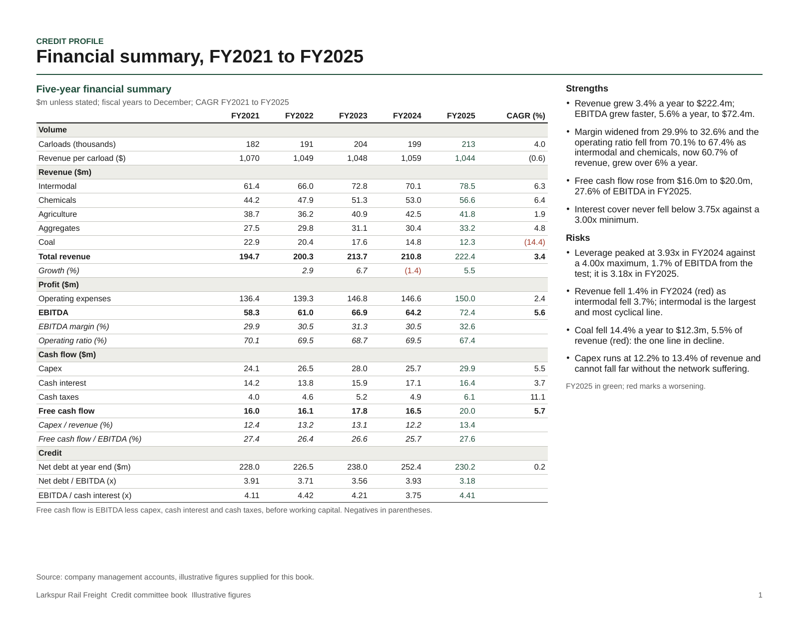

# designing-presentations

An Agent Skill, and a Claude Code plugin, that designs native, editable PowerPoint
presentations: pitch books, board decks, consulting pages, credit papers. Give it a
reference (a company template, a past deck, any .pptx, or a vector or scanned PDF) and the
new pages take that reference's look; give it none and the model reasons the look out from
the reader, the subject and the data.

The model designs; scripts measure. The model chooses the storyline, every page's
composition, every exhibit and every colour. The scripts read the reference's look as
roles with provenance, measure text fit with the real fonts, solve the geometry, write a
valid package on the reference's masters (or a blank one), render it with LibreOffice and
read the render back. Only what is measurably wrong is refused: text that does not fit or
overlaps, contrast under 3:1, a bridge that does not tie, a render that is not what the
file says, a past deck's content, an invented number.



*Page 1 of `examples/no-reference-credit.*` in the skill: a two-page credit committee
section on a fictional railroad, built with no reference, its look reasoned out from the brief. Rendered
by LibreOffice from the .pptx the build wrote.*

## Install

### Claude Code, as a plugin

```
/plugin marketplace add 0xfauzi/pptx-skill
/plugin install designing-presentations@pptx-skill
```

From a shell: `claude plugin marketplace add 0xfauzi/pptx-skill` then
`claude plugin install designing-presentations@pptx-skill`. One line does both: in a session
`/plugin install designing-presentations --marketplace 0xfauzi/pptx-skill` (Claude Code
2.1.275 or later), from a shell `claude plugin install designing-presentations --marketplace
0xfauzi/pptx-skill` (2.1.292 or later). The install copies the plugin folder only, never
`dev/`; where it lands and how to fetch the judge's panel again after an update:
[INSTALL.md](INSTALL.md). The skill then loads as `/designing-presentations:designing-presentations`, and Claude uses
it on its own when a request asks for slides.

### Claude Code, by hand

Copy (or symlink) `plugins/designing-presentations/skills/designing-presentations/` into
`~/.claude/skills/` for every project, or into a project's `.claude/skills/`. The directory name must stay
`designing-presentations`, the skill's `name`.

### claude.ai

Build the upload zip, upload it in claude.ai under Customize > Skills and turn it on (code
execution must be on):

```bash
python3 dev/tools/package_skill.py          # writes dist/designing-presentations.zip
```

The zip holds the `designing-presentations/` folder as its one top-level entry, as claude.ai
asks: the files git tracks there, as committed, without the third-party reference decks. The
packager refuses an untracked or ignored file in the skill and anything an upload would
reject (INSTALL.md lists the rules).

### Claude API

Upload the same folder through the Skills API (`POST /v1/skills`, each file sent as
`designing-presentations/<path>`) and attach it to a Messages request in
`container.skills` with the code execution tool. The API's sandbox has no network and
installs no packages, so it runs only where its pre-installed packages cover the
requirements below; `scripts/preflight.py` says which are missing.

[INSTALL.md](INSTALL.md) has every step, the requirements with the versions this was
built and measured on, and how to fetch the judge's panel of public decks.

## Requirements

Python 3.11 or later with lxml, Pillow, python-pptx and pdfplumber (uharfbuzz optional, a
better text ruler); LibreOffice, poppler and fontconfig. The skill installs nothing: run
`scripts/preflight.py` in the skill and it lists what is missing with the install command for your platform, for you to run. Versions measured, and
fonts: [INSTALL.md](INSTALL.md).

## Examples

Worked inputs ship in the skill's `examples/`: a four-page section, an annotated page, a
bridge and a round trip on a bank pitch book (pptx); two pages on a McKinsey board PDF; and
two decks with no reference at all (a board review and a dense credit paper), each with its
brief, figures script, plan, completion and page specs. Their build reports are in
`dev/proofs/`. The reference examples are derived from public decks (the bank pitch book is
a Mergers and Inquisitions training deck; the PDF a public board packet); the new pages
carry their own text, and the round trip, which rebuilds the bank deck's own page 3, keeps
its roles, weights and figures with every text run paraphrased.

## What was measured

Every number below was produced on this corpus by a script in the session that built the
skill, and each cites the file that holds it. None is estimated.

| Claim | Measurement | Proof |
|---|---|---|
| The judge tells firms apart | 152 of 165 held-out slides over 8 firms filed correctly with the shipped weights, 151 with weights re-fitted in the same run, 132 with equal weights (chance bound 29; weights fitted on the other half of the same corpus, judged leave-one-slide-out, raster pages not scored). The three Mergers and Inquisitions books are one firm (one fictional bank, one master) and the judge cannot tell them apart; it reports them as the same style, not as rivals | `scripts/fingerprint.py`, the `DEFAULT_WEIGHTS` docstring (re-run with `fingerprint.py calibrate`); firms in `dev/oracles/calibration-firms.txt` |
| The judge is not fooled by copying the master | a master-reuse deck, which inherits the reference master verbatim, is flagged as off-style | `dev/PORT_AUDIT.md`, row "Style fingerprint" |
| The judge is not fooled by a wreck in the reference's clothes | Five decks a rater calls wrong (keybank's shapes at random positions, all stacked at one point, one page-sized text box a page, nine random boxes a page, every run repeated twelve times) once filed under keybank at 0.013 to 0.192; each now reads overlap or overflow at 1.0 and fails the layout gate | `dev/oracles/README.md`, "build_gaming.py"; `scripts/fingerprint.py`, the `DEFAULT_WEIGHTS` docstring |
| The layout port is the predecessor's solver | 383 boxes over 14 specimen slides at three scales: maximum difference 0 EMU; validation findings agree on 14 of 14 | `dev/oracles/README.md`, "oracle_compare.py" |
| The text ruler is the measured one | 90 of 90 recorded wrap cases agree with HarfBuzz; 89 of 90 with the Pillow fallback the sandbox has | `dev/oracles/ruler_agreement.txt` |
| The gallery port is the predecessor's gallery | Component, candidate, cluster, crop and exemplar counts equal the predecessor's recorded manifests on three decks; crop rows match 12 of 12, 14 of 14 and 22 of 24; every exemplar skeleton identical | `dev/oracles/README.md`, "gallery_judge.py" |
| The extractor tracks the predecessor's draft | Title, body, emphasis and caption sizes, surface and ink equal the predecessor's on jazz, keybank, netflix and exhibits; 47 of 160 compared values differ (h1/h2 sizes on two decks, rule and muted ink by deliberate change, spacing steps on two), re-runnable with `dev/oracles/diff_oracle.py` | `dev/PORT_AUDIT.md`, row "OOXML reader with inheritance" |
| New pages read as the reference (judge only) | keybank: 4 generated pages with a novel football-field component, 0.083 against the reference with the reference's own pages at 0.055 to 0.372, every page fit, filed. A 17-page McKinsey board PDF (CalSTRS, 2024; a public board packet, not under `refs/`): 2 generated pages at 0.321 against a reference spread of 0.082 to 0.355: every page fit, not filed. In a blind round on an earlier build the rater caught every generated page in two firms the judge had filed, so a filed deck is necessary, not sufficient | `dev/proofs/keybank-section.build.json`, `dev/proofs/mckinsey-pdf.build.json` (`judge.total`, `judge.reference_spread`, `judge.filed_under_reference`); the blind round in `dev/evals/README.md` |
| The chain reproduces the reference's own page | keybank slide 3 imported as roles and weights, re-solved and emitted on the keybank master: fit, 0.056, filed, inside the reference's own spread; the render matches the original to the eye. McKinsey PDF page 13: 0.100, filed, while the render lost the ring diagram and the block positions: the number does not see it | `dev/proofs/kb3-rt.build.json`; `dev/proofs/mckinsey-p13-roundtrip.md` |
| PDF triage tells scans from vector exports | 19 reference PDFs classified per page; the 8 page-image decks (EDGAR prints, a bound filing, OCR scans, a stamped scan) come out `raster`, the 11 vector exports `vector`, with no deck misfiled against a reading of its renders | `dev/PORT_AUDIT.md`, row "PDF triage" |
| The raster instrument reads a render back | keybank rendered at 100 dpi and re-measured from pixels: surface and the navy exact, ink within 1 unit, left margin within 0.01 in, the other sides within 0.09 in, body 11.7pt from a modal 14pt pitch against 12pt in the file | `dev/proofs/keybank-raster-oracle.md`, "Against the file" |

The McKinsey pages are not filed; the judge's components carry the gap: fills 0.855, the
size histogram 0.698 and the bold ratio 0.537 against the reference (`judge.components` in
`dev/proofs/mckinsey-pdf.build.json`).

## Known gaps

- No arrangement search: when a page does not fit, the solver reports the splittable
  groups and the row prefix that fits, and the agent decides.
- The reference's source-line habit is counted from the digest; the share above which a missing
  source line warns (half of three or more data pages) is unmeasured.
- The leakage report's matching rules and thresholds are unmeasured; its false positives
  have not been recorded across the scenarios.
- The football-field component's tick labels sat off their values on two renders; read the
  axis on every render until it is fixed.
- Hidden slides are read as evidence (the predecessor's rule); the digest lists them and the agent
  excludes them by deleting them from a copy.
- A scanned PDF yields palette, ink, chrome, margins and line pitch from pixels (confidence
  capped at 0.5 by `scripts/raster_style.py`) and nothing about faces; the agent names the family by eye.
- The judge was calibrated on 8 firms: 16 public decks and 20 one-slide pages of the
  predecessor's taste spike (`dev/oracles/calibration-firms.txt`), and does not track a human
  rater; the blind round in `dev/evals/README.md` is the success measure.
- The scenarios in `dev/evals/` have not yet been run with fresh agents on every model tier.

## Repository layout

```
.claude-plugin/marketplace.json   the marketplace (name pptx-skill); its one plugin's source is
                                  ./plugins/designing-presentations
plugins/designing-presentations/  the plugin root, all that an install copies:
  .claude-plugin/plugin.json      the plugin manifest
  skills/designing-presentations/ the skill, self-contained: SKILL.md, references/, scripts/,
                                  components/, examples/, refs/ (fetch.sh and MANIFEST.md)
dev/                              development material, outside the plugin root, so never
                                  installed: TARGET_SPEC.md, PORT_AUDIT.md, evals/, oracles/,
                                  proofs/, tools/
docs/                             the image above
```

[dev/README.md](dev/README.md) describes the development material.

## Licence

MIT, copyright 2026 0xfauzi: [LICENSE](LICENSE). The skill carries the same text as its
`LICENSE.txt`. `scripts/confusable_letters.json` holds a
subset of the Unicode confusables data under the Unicode License v3, whose notice it carries
in full. The public reference decks `refs/fetch.sh` downloads belong to their publishers
and are never committed or shipped (`refs/MANIFEST.md` names each source).

No code or text of Anthropic's own pptx skill is included: everything here was written
fresh, and what was carried over came from a predecessor system by the same author, each
port's assumption recorded in `dev/PORT_AUDIT.md`.
