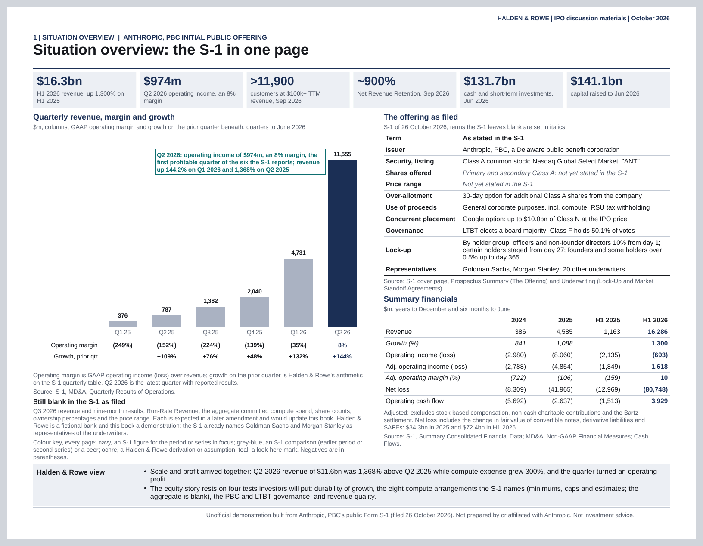
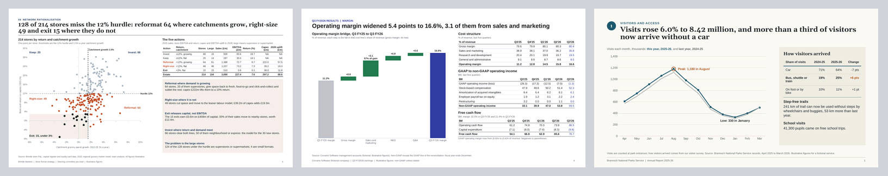

# designing-presentations

An Agent Skill, and a Claude Code plugin, with which Claude designs native, editable
PowerPoint decks: pitch books, investment committee books, consulting pages, earnings
decks, annual reports. Give it a reference (a company template, a past deck, any .pptx, or
a vector or scanned PDF) and the new pages take that reference's look; give it none and
Claude reasons a look out from the reader, the subject and the data.

Claude designs and the skill's scripts measure. Claude chooses the storyline, each page's
composition, every exhibit, every annotation and every colour. The scripts read the
reference's look, measure text with the installed fonts, solve the page geometry, write
the .pptx with native charts and tables, render it with LibreOffice, read the render back
and refuse a page whose defect can be measured.



*Page 1 of the LBO investment committee book in the gallery below, built with no
reference. Click the image for the full-size render.*

[](#gallery)

*From the other three gallery decks: page 4 of a grocery format strategy, page 4 of a
software company's quarterly results and page 1 of a national parks annual report. Every
company and figure is fictional. Each image is LibreOffice's render of the .pptx its build
wrote.*

## What it is good at

- **Any reference look, or a reasoned one.** A .pptx is read through its masters, layouts
  and theme; a PDF is triaged page by page into vector and scanned pages, and a scan is
  measured from its pixels. The guide records each value with where it came from. With no
  reference, Claude writes a short look brief (reader, subject, data, brand, restraint)
  and chooses every value itself; none has a default.
- **Dense pitch-book pages.** Many exhibits to a page, each at its measured size: the
  committee book in the gallery sets five to nine tables and charts on each letter page
  (counted in its page specs).
- **Native, editable exhibits.** Charts are PowerPoint charts with their data in the file;
  tables are PowerPoint tables. Bridges (one crossing zero among them), floating
  valuation ranges, a mekko and a price-and-volume combo chart have worked recipes in the skill's `references/chart-recipes.md`.
- **Annotation.** Reference lines, bands, brackets, callouts, badges, outline boxes, rows
  aligned to categories and any OOXML shape, placed at data positions on a chart or on
  table cells. A mark with no words says what explains it, or the build warns.
- **Logos and icons.** Pictures from the user's files, the reference's own pictures, and
  small SVG icons drawn in the deck's colour roles.
- **Measured text fit.** Every text box, table cell and label is measured in the face the
  renderer will draw: the font the deck names, or a stand-in the guide names (HarfBuzz, or
  Pillow where HarfBuzz is not installed). A page set in a face the machine lacks, with no
  stand-in named, is refused rather than measured in another face; a page that does not
  fit is reported with what to change.
- **Refusal of measurable defects.** A page is refused for text that does not fit or
  overlaps, contrast under 3:1, a bridge that does not tie, an exhibit with no written
  brief, or a render that is not what the file says (text, a table cell or a chart label
  the renderer wrapped, dropped or covered). A totals row that does not tie is warned.
  Everything else is Claude's choice, shown beside the reference's own habits.

## What to ask

- "Here is our pitch book template, `bank_template.pptx`. Build a four-page valuation
  section for Project Atlas from `comps.csv` and `model.csv`: a summary, trading comps, a
  football field with the $36.50 offer marked, and the accretion bridge."
- "No template. Write a five-page steering committee pre-read on our store format strategy
  from `stores.csv`. The audience is the board; every title should state the finding."
- "Use the look of `board_pack.pdf` (a scan) for two new pages on the capital plan."
- "Add a returns sensitivity page to `ic_book.pptx`, in the style of the deck's own pages."
- "Use our logo, `logo.png`, in place of the template firm's logo, and drop the firm's
  name from the footer."

## Install

### Claude Code, as a plugin

```
/plugin install designing-presentations --marketplace https://raw.githubusercontent.com/0xfauzi/pptx-skill/main/.claude-plugin/marketplace.json
```

That one line (Claude Code 2.1.275 or later in a session; `claude plugin install
designing-presentations --marketplace <URL>` from a shell, 2.1.292 or later) adds the
marketplace by its catalog file and installs the plugin. Claude Code downloads the catalog
file alone, and the plugin's entry fetches the plugin folder alone (a `git-subdir` source),
so nothing of `dev/` reaches the disk. Adding the marketplace as `0xfauzi/pptx-skill` also
works and clones the whole repository, `dev/` included. The skill then loads as
`/designing-presentations:designing-presentations`, and Claude uses it on its own when a
request asks for slides. Where the install lands, and how to fetch the judge's panel again
after an update: [INSTALL.md](INSTALL.md).

### Claude Code, by hand

Copy (or symlink) `plugins/designing-presentations/skills/designing-presentations/` into
`~/.claude/skills/` for every project, or into a project's `.claude/skills/`. The directory
name must stay `designing-presentations`, the skill's `name`.

### claude.ai

Build the upload zip, upload it in claude.ai under Customize > Skills and turn it on (code
execution must be on):

```bash
python3 dev/tools/package_skill.py          # writes dist/designing-presentations.zip
```

The zip holds the `designing-presentations/` folder as its one top-level entry: the files
git tracks there, as committed, without the third-party reference decks. The packager
refuses an untracked or ignored file in the skill and anything an upload would reject
(INSTALL.md lists the rules). Whether claude.ai's sandbox has LibreOffice and the packages
below depends on the environment; ask Claude to run `scripts/preflight.py` first.

### Claude API

Upload the same folder through the Skills API (`POST /v1/skills`, each file sent as
`designing-presentations/<path>`) and attach it to a Messages request in
`container.skills` with the code execution tool. The API's container has no network and
installs no packages, so the skill runs there only as far as its pre-installed packages
cover the requirements below; `scripts/preflight.py` says which are missing.

[INSTALL.md](INSTALL.md) has every step, the versions this release was measured on, and
how to fetch the judge's panel of public decks.

## Requirements

Python 3.11 or later with lxml, Pillow, python-pptx and pdfplumber (uharfbuzz optional, the
better text ruler); LibreOffice, poppler and fontconfig. The skill installs nothing: run
`scripts/preflight.py` in the skill and it lists what is missing, with the install command
for your platform, for you to run. Install the fonts your reference names (or their
metric-compatible stand-ins) before building, since text is measured with the installed
faces. Versions measured, and fonts: [INSTALL.md](INSTALL.md).

## How it works

1. **Intake.** The reference is rendered, its look extracted into a guide draft with the
   provenance of every value, and its exhibits cut into a gallery. With no reference the
   draft is blank.
2. **Guide.** Claude answers every value the reference left open (with none: all of
   them), including how the reference titles pages and marks its exhibits.
3. **Plan.** Claude writes the storyline and, for each exhibit, a brief: what the reader
   must see, the forms weighed and why one was chosen, where the claim is marked. A script
   computes and asserts every figure a title states.
4. **Page specs.** Each page is a tree of regions and elements written in roles (a type
   role, a colour role, a spacing step), never a literal size, colour or coordinate.
5. **Build.** The solver places every box, the text ruler measures every line, the emitter
   writes the .pptx on the reference's masters (or a blank one), LibreOffice renders it
   and the build reads the render back. A page with a measurable defect is refused with
   what to change.
6. **Review.** Claude looks at every render at full size against each exhibit's brief,
   fixes, and rebuilds, then validates the package.

The whole workflow, step by step: the skill's
[SKILL.md](plugins/designing-presentations/skills/designing-presentations/SKILL.md).

## Gallery

Four decks built with no reference, each from its figures script, plan, completion and
page specs, on the skill in this repository. Each build passed every gate and both package
validations. The sources and the command that rebuilds each deck and image are in
[dev/showcase/](dev/showcase/README.md).

| Deck | Pages | All pages | File |
|---|---|---|---|
| LBO investment committee book: company overview, sources and uses, operating model, returns and sensitivities, debt capacity, exit (US letter) | 6 | [image](docs/showcase/lbo-committee-book.png) | [.pptx](docs/showcase/lbo-committee-book.pptx) |
| Grocery store format strategy: market shift, format economics, customer segments, network rationalisation, three-year plan | 5 | [image](docs/showcase/grocery-strategy.png) | [.pptx](docs/showcase/grocery-strategy.pptx) |
| Software company quarterly results: highlights, revenue and ARR, unit economics, margin, guidance | 5 | [image](docs/showcase/software-earnings.png) | [.pptx](docs/showcase/software-earnings.pptx) |
| National parks annual report: visitors, conservation, budget, volunteers, priorities | 5 | [image](docs/showcase/parks-annual-report.png) | [.pptx](docs/showcase/parks-annual-report.pptx) |

The skill's own `examples/` hold worked inputs with a reference: a four-page section, four
annotated pages, two bridge pages and a round trip on a bank pitch book (pptx), and two
pages on a McKinsey board PDF; and two more decks with no reference (a three-page board
review and a two-page credit paper). Their build reports are in `dev/proofs/`. The
reference examples are derived from public decks (the bank pitch book is a Mergers and
Inquisitions training deck; the PDF a public board packet); the new pages carry their own
text, and the round trip, which rebuilds the bank deck's own page 3, keeps its roles,
weights and figures with every text run paraphrased.

## Limits and known gaps

- **No arrangement search.** When a page does not fit, the solver reports the splittable
  groups and the row prefix of each table that fits (`scripts/layout.py`); Claude
  re-arranges, cuts words or splits the page.
- **One renderer.** Every render check reads LibreOffice 24.2.7's drawing. PowerPoint was
  measured for text-box fit and table row heights (`references/gotchas.md`); chart label
  and annotation positions, and the label gaps and ink bands per face and size, were
  measured in LibreOffice only (`dev/PORT_AUDIT.md`). The order PowerPoint lists a
  horizontal bar chart's legend in is unmeasured; LibreOffice lists it last series first.
- **Half-point sizes draw wider in LibreOffice.** At 7.5pt LibreOffice set Liberation Sans
  and Carlito lines 0.69 to 0.80% wider than the text ruler measures them (8pt: 0.07 to
  0.33%; 7, 9, 10 and 12pt from 0.78% narrower to 0.06% wider), more than the fitter's 20,234 EMU
  margin on a line longer than about 2.6 million EMU (2.8 in). A table cell or text line
  that the renderer wraps for it is refused at render time (`renderer divergence`), not
  predicted before it.
- **Chart text spacing.** LibreOffice draws Carlito (Calibri's stand-in) chart labels at 7pt
  with collapsed word spaces ("Water andwastewater") and at 7.5 and 8pt with gaps inside
  words ("Wat er"); setting `kern` on the chart text changed nothing, and 8.5 and 9pt drew
  within the measured bounds. The committee book in the gallery sets its 7pt chart text in
  Arial for this (`dev/PORT_AUDIT.md`, docs round 2). Liberation Sans (Arial) chart labels
  are spaced unevenly too: figures such as "(30.0)" drew with gaps and overlaps between
  glyphs of 0.25 to 0.42 of a space at 7, 7.5, 8, 8.5 and 9pt bold and at 7pt regular, where the
  same figures as text boxes drew within 0.06 (docs round 3). The committee book's bridge
  sets its figures as a row of text above the plot (`category_row`).
- **Leakage and stated figures are reported, not refused.** The build lists every name,
  figure and phrase of the reference found in the new deck, and warns where a figure the
  plan's message states is not on the page; Claude removes or answers each in the final
  report. The leakage report's matching rules and thresholds are unmeasured, and its false
  positives have not been recorded across the scenarios.
- **Source-line habit.** A data page without a source line warns where at least half of
  the reference's data pages carry one (counted over three or more data pages), and also
  where the habit is unmeasured (the digest has no answer, or the reference has fewer than
  three data pages); both lines are definitions in `scripts/build_deck.py`
  (`SOURCE_LINE_MAJORITY`, `SOURCE_LINE_MIN_PAGES`), not measurements.
- **Football-field ticks.** The football-field component sets each axis tick label
  starting at its value (left-aligned, not centred on it), except the last, which it
  right-aligns at the end of the track; it drops a tick whose label does not fit its
  interval (`components/football_field/expand.py`). On the keybank example the $14 tick
  is not drawn: the build report holds ticks `ff-tk0` to `ff-tk3` and `ff-tk5` and no
  `ff-tk4` (`dev/proofs/keybank-section.build.json`). Read the axis on every render.
- **Hidden slides** are read as evidence (the predecessor's rule); the draft lists them,
  and Claude excludes them by deleting them from a copy.
- **Scanned PDFs** yield palette, ink, chrome, margins and line pitch from pixels, with
  confidence capped at 0.5 (`scripts/raster_style.py`), and nothing about faces: Claude
  names the family by eye.
- **The judge** was calibrated on 8 firms: 16 public decks and 20 one-slide pages of the
  predecessor's taste spike (`dev/oracles/calibration-firms.txt`). It does not track a
  human rater: in a blind round on an earlier build the rater caught every generated page
  in two firms the judge had filed (`dev/evals/README.md`).
- **Model tiers.** No results of the scenarios in `dev/evals/` are recorded per model tier.

## What was measured

Each number below was produced by a script on the corpus its row names, and cites the
file that holds it.

| Claim | Measurement | Proof |
|---|---|---|
| The judge tells firms apart | 152 of 165 held-out slides over 8 firms filed correctly with the shipped weights, 151 with weights re-fitted in the same run, 132 with equal weights (chance bound 29; weights fitted on the other half of the same corpus, judged leave-one-slide-out, raster pages not scored). The three Mergers and Inquisitions books are one firm (one fictional bank, one master) and the judge cannot tell them apart; it reports them as the same style, not as rivals | `scripts/fingerprint.py`, the `DEFAULT_WEIGHTS` docstring (re-run with `fingerprint.py calibrate`); firms in `dev/oracles/calibration-firms.txt` |
| The judge is not fooled by copying the master | a master-reuse deck, which inherits the reference master verbatim, is flagged as off-style | `dev/PORT_AUDIT.md`, row "Style fingerprint" |
| The judge is not fooled by a wreck in the reference's clothes | Five decks a rater calls wrong (keybank's shapes at random positions, all stacked at one point, one page-sized text box a page, nine random boxes a page, every run repeated twelve times) each read overlap or overflow at 1.0 and fail the layout gate. Before those two components, four of them were filed under keybank at 0.013 to 0.192 | `dev/oracles/README.md`, "build_gaming.py"; `scripts/fingerprint.py`, the `DEFAULT_WEIGHTS` docstring |
| The layout port is the predecessor's solver | 383 boxes over 14 specimen slides at three scales: maximum difference 0 EMU; validation findings agree on 14 of 14 | `dev/oracles/README.md`, "oracle_compare.py" |
| The text ruler is the measured one | 90 of 90 recorded wrap cases agree with HarfBuzz; 89 of 90 with the Pillow fallback | `dev/oracles/ruler_agreement.txt` |
| The gallery port is the predecessor's gallery | Component, candidate, cluster, crop and exemplar counts equal the predecessor's recorded manifests on three decks; crop rows match 12 of 12, 14 of 14 and 22 of 24; every exemplar skeleton identical | `dev/oracles/README.md`, "gallery_judge.py" |
| The extractor tracks the predecessor's draft | Title, body, emphasis and caption sizes, surface and ink equal the predecessor's on jazz, keybank, netflix and exhibits; 47 of 160 compared values differ (h1/h2 sizes on two decks, rule and muted ink by deliberate change, spacing steps on two), re-runnable with `dev/oracles/diff_oracle.py` | `dev/PORT_AUDIT.md`, row "OOXML reader with inheritance" |
| New pages read as the reference (judge only) | keybank: 4 generated pages with a novel football-field component, 0.083 against the reference with the reference's own pages at 0.055 to 0.372, every page fit, filed. A 17-page McKinsey board PDF (CalSTRS, 2024; a public board packet, not under `refs/`): 2 generated pages at 0.321 against a reference spread of 0.082 to 0.355: every page fit, not filed. A filed deck is necessary, not sufficient (the blind round above) | `dev/proofs/keybank-section.build.json`, `dev/proofs/mckinsey-pdf.build.json` (`judge.total`, `judge.reference_spread`, `judge.filed_under_reference`); the blind round in `dev/evals/README.md` |
| The chain reproduces the reference's own page | keybank slide 3 imported as roles and weights, re-solved and emitted on the keybank master: fit, 0.056, filed, inside the reference's own spread; the render matches the original to the eye. McKinsey PDF page 13: 0.100, filed, while the render lost the ring diagram and the block positions: the number does not see it | `dev/proofs/kb3-rt.build.json`; `dev/proofs/mckinsey-p13-roundtrip.md` |
| PDF triage tells scans from vector exports | 19 reference PDFs classified per page; the 8 page-image decks (EDGAR prints, a bound filing, OCR scans, a stamped scan) come out `raster`, the 11 vector exports `vector`, with no deck misfiled against a reading of its renders | `dev/PORT_AUDIT.md`, row "PDF triage" |
| The raster instrument reads a render back | keybank rendered at 100 dpi and re-measured from pixels: surface and the navy exact, ink within 1 unit, left margin within 0.01 in, the other sides within 0.09 in, body 11.7pt from a modal 14pt pitch against 12pt in the file | `dev/proofs/keybank-raster-oracle.md`, "Against the file" |

The McKinsey pages are not filed; the judge's components carry the gap: fills 0.855, the
size histogram 0.698 and the bold ratio 0.537 against the reference (`judge.components` in
`dev/proofs/mckinsey-pdf.build.json`).

## Repository layout

```
.claude-plugin/marketplace.json   the marketplace (name pptx-skill); its one plugin's source is
                                  plugins/designing-presentations of this repository (git-subdir)
plugins/designing-presentations/  the plugin root, all that an install copies:
  .claude-plugin/plugin.json      the plugin manifest, and icon.png, its listing icon
  README.md                       the directory listing's description: what the plugin runs,
                                  sends, fetches and writes
  skills/designing-presentations/ the skill, self-contained: SKILL.md, references/, scripts/,
                                  components/, examples/, refs/ (fetch.sh and MANIFEST.md)
dev/                              development material, outside the plugin root, so never
                                  installed: TARGET_SPEC.md, PORT_AUDIT.md, evals/, oracles/,
                                  proofs/, showcase/ (the gallery decks' sources), tools/
docs/showcase/                    the images above and the gallery decks' .pptx files
```

[dev/README.md](dev/README.md) describes the development material.

## Licence

MIT, copyright 2026 0xfauzi: [LICENSE](LICENSE). The skill carries the same text as its
`LICENSE.txt`. `scripts/confusable_letters.json` holds a subset of the Unicode confusables
data under the Unicode License v3, whose notice it carries in full. The public reference
decks `refs/fetch.sh` downloads belong to their publishers and are never committed or
shipped (`refs/MANIFEST.md` names each source).

No code or text of Anthropic's own pptx skill is included: everything here was written
fresh, and what was carried over came from a predecessor system by the same author, each
port's assumption recorded in `dev/PORT_AUDIT.md`.
